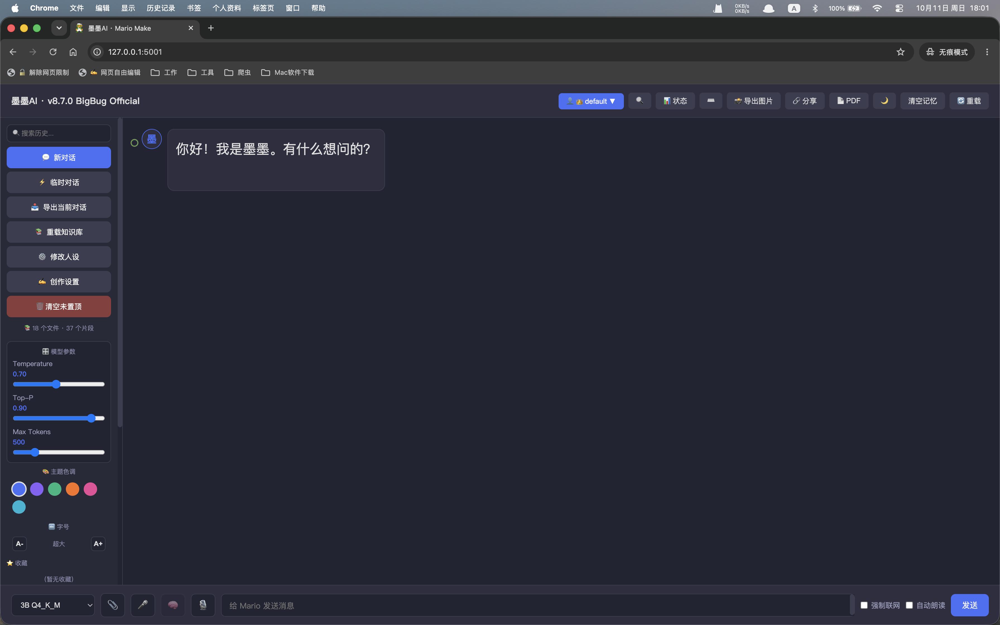
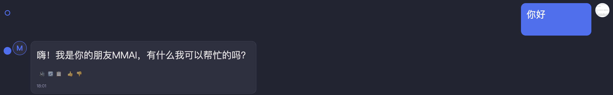

# 墨墨AI（Mario Make AI）· 本地助手

<p align="center">
  
  
</p>


> 中文名「墨墨」，英文名「Mario Make」
> M /m/（墨）· M /m/（墨）AI —— 一个住在你电脑里的本地 AI。

一个完全本地运行的中文 AI 聊天助手，基于 Qwen2.5 + llama.cpp，
带 Web 界面、菜单栏快捷唤起、OpenAI 兼容 API、权限分层、情感感知、个性化创作。

---

## 📋 项目简介

- **模型**：Qwen2.5-3B / 1.5B（GGUF 量化，3 个版本可切换）
  - **3B Q4_K_M**（2.0G）：质量优先，日常主力
  - **1.5B Q4_K_M**（1.0G）：速度优先，快速问答
  - **1.5B Q2_K**（718M）：极速模式，应急使用
- **推理**：llama-cpp-python（纯 CPU）
- **界面**：Flask + 原生 HTML/CSS/JS
- **特点**：离线运行、多用户档案、权限分层、旁观模式、向量 RAG、图片 OCR、语音交互、文件上传、OpenAI 兼容 API、架构自愈

---

## ✨ 功能特性


### 🎮 少儿编程联动 (Scratch / TurboWarp)

- **可视化编程**：内置 `momo-extension.js`，支持在 TurboWarp 中直接加载。
- **积木化调用**：通过自定义积木 `Ask MoMo [PROMPT]`，让 Scratch 角色拥有本地 AI 大脑。
- **跨域安全**：后端已内置 CORS 支持，方便对接各种本地前端。

### 🗣️ 对话核心

| 功能 | 说明 |
| :--- | :--- |
| 🗣️ 本地对话 | 完全离线，不依赖任何云 API |
| 🌊 流式输出 | 逐字显示，体验接近 ChatGPT |
| 📝 Markdown 渲染 | 代码高亮、表格、列表、引用 |
| 🎭 多模型切换 | 3 个 Qwen2.5 量化版本热切换 |
| 🔄 重新生成 | AI 回答不满意，一键重答 |
| ⏹ 停止生成 | 回答中途可手动停止 |
| ✏️ 消息编辑 | 用户消息可改，改完重新生成 |

### 🧠 记忆与知识

| 功能 | 说明 |
| :--- | :--- |
| 🧠 持久记忆 | 每个会话独立保存，重启不丢 |
| 📚 向量 RAG | 语义检索（BAAI/bge-small-zh-v1.5） |
| 🎯 关键词优先 | 常见问答 0 秒响应 |
| 🕐 时间查询 | 自动识别时间类问题 |
| 🌐 联网搜索 | 自动或手动触发 DuckDuckGo |
| 🔧 多意图 | 一句话同时触发时间 + 搜索 |
| 🧠 真·思考模型 | Ollama 后端，Qwen3 / R1 流式思考渲染 |

### 👥 用户与权限

| 功能 | 说明 |
| :--- | :--- |
| 👥 多用户档案 | 每个用户独立的会话、人设、名字、设置 |
| 👑 权限分层 | default 为管理员，普通用户完全隔离 |
| 👁️ 旁观模式 | 管理员可切换到其他用户，只读查看 |
| 📸 管理员导出 | default 可导出任意用户会话为 PNG |
| 🔐 访问密码 | 可选，设置后需登录 |
| 👤 记住用户名字 | 跨会话识别并称呼 |

### 📎 文件与 OCR

| 功能 | 说明 |
| :--- | :--- |
| 📎 文件上传 | PDF / DOCX / PPTX / TXT / MD / 代码 / 图片 |
| 📷 图片 OCR | RapidOCR 识别，中文识别率 ~95% |
| 📝 OCR 入库 | 识别结果自动存进知识库 |

### ✍️ 个性化

| 功能 | 说明 |
| :--- | :--- |
| 🎭 情感感知 | 识别 7 种情绪，调整 AI 回应语气 |
| ✍️ 个性化创作 | 写作风格 / 个人词典 / 场景人设 |
| 💡 提示词模板 | 侧边栏 6 个快捷按钮 |

### 💬 会话管理

| 功能 | 说明 |
| :--- | :--- |
| 🗂️ 多会话侧边栏 | 新建、切换、双击重命名、置顶、导出 |
| 🔍 跨会话搜索 | 搜关键词，跳转后自动高亮匹配消息 |
| 📁 文件夹分组 | 会话右键归入自定义文件夹 |
| 🧭 右侧对话大纲 | 列出你的每次提问，点击平滑跳转 |
| ⚡ 临时对话 | 不进历史、不落盘，刷新即消失 |

### 🎨 界面与交互

| 功能 | 说明 |
| :--- | :--- |
| 🎨 主题三态 | 深色 / 浅色 / 跟随系统 |
| ⌨️ 全局快捷键 | 新对话、搜索、保存、发送、停止 |
| ⌨️ 快捷键面板 | 顶栏按钮或按 `?` 查看全部快捷键 |
| 📝 输入框多行 | `Enter` 发送 / `Shift+Enter` 换行 |
| 📋 代码块一键复制 | 每个代码块 hover 出现复制按钮 |
| 🕐 消息时间戳 | 每条消息 hover 显示发送时间 |
| 📊 系统状态面板 | 显示模型 / CPU / 内存 / 进程占用 / 运行时长 |
| 🎛️ 模型参数滑杆 | 侧边栏实时调 Temperature / Top-P / Max Tokens |
| ↓ 回到底部按钮 | 往上滚时右下角浮出，点击平滑回底 |
| ◀ 侧边栏折叠 | 一键收起/展开，状态记忆 |
| 📖 长消息折叠 | 超长 AI 回复自动折叠，可展开 |
| 🎨 主题色调 | 6 色可选，存 localStorage |
| 🔤 字号调节 | A- / A+ 五档 |
| 📄 导出 PDF | 浏览器打印，只输出聊天内容 |
| 📊 侧边栏图标化 | 图标 + 文字，Cmd+B 收窄 |

### 🛠️ 工具与导出

| 功能 | 说明 |
| :--- | :--- |
| 📋 一键复制 | 每条消息（用户 + AI）均可复制 |
| 📸 导出为图片 | 一键把对话导出成漂亮长图 |
| 📥 导出为 Markdown | 下载 `.md` 文件，适合存档 |
| 🌐 翻译模式 | 选中文字弹气泡一键翻译 |
| ✅ 待办提取 | 「记一下 xxx」自动写入 `docs/todo.md` |

### 🧠 思考与智能

| 功能 | 说明 |
| :--- | :--- |
| 🧠 真·思考模型 | Ollama 后端，Qwen3 / R1 流式思考渲染 |
| 🎛️ 思考开关 | 页脚 🧠 三态：自动 / 强制 / 关闭 |
| 🔀 双后端 | llama-cpp-python + Ollama 共存 |

### 💬 会话增强

| 功能 | 说明 |
| :--- | :--- |
| ⭐ 消息收藏 | hover 收藏，侧边栏列出 |
| 🔍 对话内搜索 | `Cmd + Shift + F` 实时高亮 |
| 📎 @ 引用消息 | 输入 `@` 引用历史消息 |
| 🖼️ 头像上传 | 用户菜单更换，自动裁方 |
| 🕐 消息时间轴 | 左侧竖线 + 圆点 |
| ⌨️ 代码块全屏 | 右上角 ⛶ 全屏看代码 |
| 👍👎 消息反应 | AI 回答打分，持久保存 |
| 🔢 代码块行号 | 超 3 行自动显示行号 |
| 🎛️ 模型快捷面板 | 卡片式选模型，带标签 |
| 🔗 对话分享 | 导出独立 HTML |
| 🎙️ 本地语音识别 | faster-whisper 离线转文字，中文识别 ~95% |

### 🔗 集成与扩展

| 功能 | 说明 |
| :--- | :--- |
| 🌐 OpenAI 兼容 API | Chatbox / NextChat 等客户端可连 |
| 🍄 菜单栏唤起 | `quick.py` 常驻菜单栏，结果自动进剪贴板 |

### 🛡️ 系统与安全

| 功能 | 说明 |
| :--- | :--- |
| 🎤 语音输入 | 浏览器原生语音识别 |
| 🔊 语音朗读 | AI 回答朗读，支持自动朗读 |
| 🛡️ 重复截断 | 检测到复读时自动停止 |
| 📄 404 / 500 | 自定义错误页面 |
| 💾 自动备份 | 每次启动打包关键文件，保留 30 份 |
| 🩺 架构自愈 | 用户目录误删后自动重建 |
| 🧨 恢复出厂设置 | 一键清空用户数据并重建 default |
| 🔊 启动提示音 | 服务器就绪时三声提示 |

---

## 📁 项目结构

```text
MarioMakeChat/
├── server.py                          # Flask 后端
├── rag.py                             # 向量 RAG 模块
├── quick.py                           # 菜单栏快捷唤起
├── restore.py                         # 备份恢复脚本
├── templates/
│   ├── index.html                     # 主界面
│   ├── login.html                     # 登录页
│   ├── 404.html
│   └── 500.html
├── static/
│   ├── avatar.png
│   └── favicon.png
├── users/                             # 多用户数据
│   ├── default/
│   └── <用户名>/
├── docs/                              # RAG 知识库
│   ├── config.md
│   ├── todo.md                        # 待办提取
│   ├── ocr_xxx_时间戳.md              # OCR 自动入库
│   └── .rag_cache.npz
├── master/                            # GGUF 模型文件
│   ├── qwen2.5-1.5b-instruct-q4_k_m.gguf
│   ├── qwen2.5-1.5b-instruct-q2_k.gguf
│   └── qwen2.5-3b-instruct-q4_k_m.gguf
├── backups/                           # 自动备份
├── RUN.bash                           # 启动脚本
├── README.md
└── CHANGELOG.md
```

---


## ⚠️ 已知限制

- **无一键安装**：需手动装 conda、下载 GGUF 模型、安装 tesseract / ffmpeg
- **纯 CPU 推理**：3B 模型约 5-15 tokens/s，无 GPU 加速
- **生图走 Pollinations**：需联网，不是纯离线
- **仅在 macOS 测试**：Linux / Windows 未验证
- **首次启动较慢**：加载模型 + RAG 嵌入约 10-30 秒
- **Ollama 思考模型需另装**：`ollama pull qwen3:1.7b`

## 🚀 快速开始

### 1. 环境准备

1. 打开 Miniconda 归档页 https://repo.anaconda.com/miniconda/，下载 `MacOSX-x86_64.pkg`（Intel Mac）
2. 双击安装，一路继续
3. 安装完成后重开终端，看到 `(base)` 即成功

```bash
conda create -n qwen_env python=3.10
conda activate qwen_env

python -m pip install flask llama-cpp-python ddgs opencc-python-reimplemented
python -m pip install pypdf python-docx python-pptx pillow pytesseract
python -m pip install sentence-transformers==2.7.0 transformers==4.36.2
python -m pip install modelscope psutil
```

> **注意**：装包请用 `python -m pip install`，避免装到系统 Python。

### 2. 安装 tesseract（OCR 用）

```bash
brew install tesseract
```

**下载中文语言包**：

```bash
sudo mv ~/Downloads/chi_sim.traineddata /usr/local/share/tessdata/
```

或：

```bash
sudo curl -L -o /usr/local/share/tessdata/chi_sim.traineddata \
  https://cdn.jsdelivr.net/gh/tesseract-ocr/tessdata_fast@main/chi_sim.traineddata
```

验证：

```bash
tesseract --list-langs
# 应看到 chi_sim
```

### 3. 下载模型

```bash
cd /Users/pp/Desktop/MarioMakeChat/master

python -c "
from modelscope import snapshot_download
snapshot_download('Qwen/Qwen2.5-3B-Instruct-GGUF', cache_dir='.', allow_patterns=['*q4_k_m*'])
snapshot_download('Qwen/Qwen2.5-1.5B-Instruct-GGUF', cache_dir='.', allow_patterns=['*q4_k_m*', '*q2_k*'])
"

# 移动到 master 根目录
find . -name "*.gguf" -not -path "./qwen2.5*" -exec mv {} . \;
rm -rf ./Qwen ./models
ls -lh *.gguf
```

### 4. 启动服务

```bash
cd /Users/pp/Desktop/MarioMakeChat
lsof -ti:5001 | xargs kill -9 2>/dev/null
/bin/bash RUN.bash
```

`RUN.bash` 内容：

```bash
#!/bin/bash
cd /Users/pp/Desktop/MarioMakeChat
/opt/miniconda3/envs/qwen_env/bin/python server.py
```

### 5. 打开浏览器

```text
http://127.0.0.1:5001
```

### 6. 菜单栏快捷唤起（可选）

```bash
conda activate qwen_env
pip install rumps pyperclip requests
python quick.py
```

菜单栏出现 🍄 图标后：

| 操作 | 效果 |
| :--- | :--- |
| 🍄 → 💬 问墨墨… | 弹出输入框，结果自动进剪贴板 |
| 🍄 → 📋 问剪贴板内容 | 复制任意内容 → 一键处理 |
| 🍄 → 🧹 清空墨墨记忆 | 重置当前会话 |
| 🍄 → 🌐 打开完整界面 | 打开浏览器主界面 |

### 7. 后台启动（可选）

项目文件夹里建 `重启墨墨.command`：

```bash
#!/bin/bash
cd /Users/pp/Desktop/MarioMakeChat
lsof -ti:5001 | xargs kill -9 2>/dev/null
sleep 1

export HF_HUB_OFFLINE=1
export TRANSFORMERS_OFFLINE=1
export TOKENIZERS_PARALLELISM=false

nohup /opt/miniconda3/envs/qwen_env/bin/python server.py > /tmp/mmai.log 2>&1 &
echo "✅ 墨墨已在后台启动，日志：/tmp/mmai.log"
```

```bash
chmod +x 重启墨墨.command
```

双击即可后台重启，终端自动关闭。

---

## ⌨️ 快捷键

| Mac 快捷键 | 功能 |
| :--- | :--- |
| `Control + ⌥ + N` | 新对话 |
| `Control + ⇧ + S` | 聚焦搜索 |
| `Control + S` | 保存对话（下载 `.md`） |
| `Control + Enter` | 发送 |
| `Esc` | 停止生成 |
| `/` | 快速聚焦搜索 |
| `Command + D` | 切回 default 管理员身份 |

---

## 🎛️ 使用说明

### 个性化（v8.3.0+）

- **🎨 主题色调**：侧边栏点彩点，6 色可选，深浅主题自动适配。
- **🔤 字号**：`A-` / `A+` 五档，影响消息字体大小。
- **📄 导出 PDF**：顶栏 📄 PDF → 浏览器打印 → 「存储为 PDF」。
- **📊 侧边栏收窄**：`Cmd + B`（Mac）/ `Ctrl + B`（Win），图标模式，悬浮显示名称。

### 快捷操作（v8.1.0 / v8.2.0+）

- **⭐ 收藏消息**：hover 消息 → ⭐
- **🔍 对话内搜索**：`Cmd + Shift + F`
- **📎 引用消息**：输入框打 `@`
- **⌨️ 代码全屏**：代码块 hover → ⛶
- **🖼️ 换头像**：用户名菜单 → 更换头像

### 真·思考模型（v8.0.0+）

通过 Ollama 接入思考模型（如 Qwen3-1.7B）：

1. 安装 [Ollama](https://ollama.com/download)
2. `ollama pull qwen3:1.7b`
3. 墨墨下拉框选 **`Qwen3-1.7B 🧠思考`**
4. 回答前会出现「💭 思考中…」→「✅ 已思考 ⌄」，点开看完整推理

本地模型（3B / 1.5B）走 llama-cpp，思考模型走 Ollama，互不干扰。

### 界面交互（v7.4.0+）

- **回到底部**：往上滚动后右下角浮出 `↓`，点击平滑回底。
- **侧边栏折叠**：侧边栏右侧小三角，点一下收起，再点展开，刷新不丢。
- **长消息折叠**：AI 回复超过 420px 自动折叠 + 「展开全部 ▼」，点击展开。

### 权限分层（v6.0.0+）

| 能力 | default（管理员） | 普通用户 |
| :--- | :---: | :---: |
| 查看完整用户列表 | ✅ | ❌ |
| 切换到其他用户 | ✅ | ❌ |
| 在别人用户下查看会话 | ✅（只读旁观） | — |
| 在别人用户下发消息 / 删会话 | ❌ | — |
| 删除其他用户 | ❌ | — |
| 导出别人会话 PNG | ✅ | ❌ |
| 操作自己的数据 | ✅ | ✅ |

### 旁观模式

当 `default` 切换到其他用户时：

- 顶部出现**橙色横幅**：`👁️ 正在旁观 xxx 的会话 · 只读模式`
- 输入框禁用
- 侧边栏写操作按钮置灰
- 点横幅右侧的 **🚪 退出旁观** 退出

### 个性化创作（v6.3.0+）

点侧边栏「✍️ 创作设置」：

| 项 | 选项 |
| :--- | :--- |
| **语气** | 😊 轻松口语 / 🎩 正式专业 / 🤣 幽默俏皮 / 🧊 严肃理性 |
| **长度** | 📏 简短直接 / 📐 适中 / 📚 详细展开 |
| **emoji** | 开 / 关 |
| **个人词典** | 每行 `词语=含义` |

个人词典示例：

```
MMAI=墨墨 AI 的缩写，我的本地 AI 助手项目
FMC SMO=我的笔名，不要拆开翻译
```

### 多用户档案

点顶栏 **👤 用户名 ▼** 打开菜单：

| 操作 | 说明 |
| :--- | :--- |
| 点击用户名 | 切换到该用户（仅 default） |
| ＋ 新建用户 | 创建独立档案（仅 default） |
| ✏️ 重命名当前用户 | default 用户不能改名 |
| 🗑️ 删除当前用户 | 删完自动切回 default |

### 切换模型

底部下拉框切换 3 个量化版本：

| 模型 | 大小 | 速度 | 质量 | 推荐场景 |
| :--- | :--- | :--- | :--- | :--- |
| **3B Q4_K_M** | 2.0G | 🐢 慢 | 🏆 最好 | 日常主力 |
| **1.5B Q4_K_M** | 1.0G | ⚡ 快 | ✅ 好 | 快速问答 |
| **1.5B Q2_K** | 718M | 🚀 极快 | ⚠️ 较差 | 应急模式 |

### 文件上传 + OCR

**图片会被 RapidOCR 识别**（PaddleOCR 轻量版），中文识别率 ~95%。

**两种模式**：
- **纯抄写**：问「写了什么」「识别」「提取」→ **直接返回原文**，0 延迟、不幻觉
- **解释**：问「什么意思」「解释一下」→ 走 LLM 分析

识别结果自动存入 `docs/`，下次重载知识库后可被 RAG 检索。

**旧引擎**：Tesseract 保留作为 fallback（RapidOCR 加载失败时自动切换）。

| 类型 | 扩展名 |
| :--- | :--- |
| 文档 | `.pdf`、`.docx`、`.pptx` |
| 文本 | `.txt`、`.md` |
| 代码 | `.py`、`.js`、`.json`、`.html`、`.css` 等 |
| **图片** | **`.png`、`.jpg`、`.jpeg`、`.gif`、`.bmp`、`.webp`** |

**图片会被 OCR 识别**，识别结果自动存入 `docs/`，可被 RAG 检索。

### 向量 RAG

把 `.txt` / `.md` / `.pdf` 放进 `docs/`：

- 网页点「🔄 重载知识库」→ 立即生效
- 或重启服务器自动加载

**v6.3.1 RAG 优化**：

- 闲聊过滤：短问题（<6 字）不触发
- 动态阈值：短问题 0.45 / 长问题 0.30
- 相关性过滤：`max_score < 0.6` 且非知识库问题 → 跳过

---

## 🌐 OpenAI 兼容 API

### 接口

| 端点 | 方法 | 说明 |
| :--- | :--- | :--- |
| `/v1/models` | GET | 列出可用模型 |
| `/v1/chat/completions` | POST | 对话（支持流式） |

### curl 测试

```bash
curl http://127.0.0.1:5001/v1/chat/completions \
  -H "Content-Type: application/json" \
  -d '{
    "model": "3B Q4_K_M",
    "messages": [{"role": "user", "content": "你好"}],
    "stream": false
  }'
```

### 接入 Chatbox

| 字段 | 值 |
| :--- | :--- |
| 模型提供方 | OpenAI API |
| API Key | `sk-local` |
| API Host | `http://127.0.0.1:5001/v1` |
| 模型 | `3B Q4_K_M` |

### 手机 / iPad 访问

1. 查 Mac 局域网 IP：
   ```bash
   ipconfig getifaddr en0
   ```
2. 修改 `server.py` 最后一行：
   ```python
   app.run(host="0.0.0.0", port=5001, debug=False, use_reloader=False)
   ```
3. 手机客户端填 `http://192.168.x.x:5001/v1`

> **安全提醒**：`0.0.0.0` 会让同 Wi-Fi 设备都能访问。

---

## ⚙️ 配置说明

### `server.py` 顶部

```python
CTX_SIZE = 8192          # 上下文窗口
THREADS = 4              # CPU 线程数
MAX_TOKENS = 500         # 最大生成长度
TEMPERATURE = 0.7        # 随机性
TOP_P = 0.9              # 核采样
SEARCH_RESULTS = 5       # 搜索返回条数
MAX_FILE_TEXT = 1500     # 文件解析截断
ACCESS_PASSWORD = ""     # 留空 = 不启用访问密码
BACKUP_KEEP = 30         # 保留多少份备份
```

### `rag.py` 顶部

```python
CHUNK_SIZE = 400         # 文档分块大小
CHUNK_OVERLAP = 80       # 块间重叠
TOP_K = 3                # 返回片段数
MIN_SCORE = 0.35         # 余弦相似度阈值
MODEL_NAME = "BAAI/bge-small-zh-v1.5"
```

---

## 🔧 常见问题

### 用户目录被误删 / 系统崩溃

v5.7 已内置自愈机制。重启即可自动重建 `users/default/`。

### 恢复出厂设置

```bash
curl -X POST http://127.0.0.1:5001/api/reset_factory
```

### 被锁在普通用户里了，怎么回 default？

1. 按 `Command + D`
2. 清 Cookie
3. 访问 `http://127.0.0.1:5001/logout`

### 启动报「未知模型：xxx」

改过 `AVAILABLE_MODELS` 后，旧名字留在 `settings.json` 里。修复：

```bash
python -c "
import json
p = 'users/default/settings.json'
with open(p) as f: d = json.load(f)
d.pop('current_model', None)
with open(p, 'w', encoding='utf-8') as f: json.dump(d, f, ensure_ascii=False, indent=2)
"
```

### 模型文件变 0 字节

modelscope 下载时会覆盖同名文件。重新下载：

```bash
cd master
python -c "from modelscope import snapshot_download; snapshot_download('Qwen/Qwen2.5-1.5B-Instruct-GGUF', cache_dir='.', allow_patterns=['*q4_k_m*'])"
find . -name "*.gguf" -exec mv {} . \;
rm -rf ./Qwen ./models
```

### 启动时 HuggingFace 超时

在启动脚本里加：

```bash
export HF_HUB_OFFLINE=1
export TRANSFORMERS_OFFLINE=1
export TOKENIZERS_PARALLELISM=false
```

### RAG 误命中无关内容

调 `server.py` 里 RAG 段的阈值：

```python
if max_score < 0.6 and not is_kb_question:
```

提高 `0.6` → `0.65` 更严，降低 → 更宽松。

### 1.5B Q2_K 复读系统指令

低量化固有缺陷，换 Q4_K_M 或 3B。

### 端口被占用

```bash
lsof -ti:5001 | xargs kill -9
```

### 模型文件找不到

```bash
find ./master -name "*.gguf"
```

### 页面显示成源码

`<script>` 标签没闭合。检查：

```bash
grep -c "<script" templates/index.html
grep -c "</script>" templates/index.html
```

数量必须一致。

### 回答重复

调高 `repeat_penalty`：

```python
repeat_penalty=1.4  →  1.5
```

### 嵌入模型报 `NameError: name 'nn' is not defined`

```bash
/opt/miniconda3/envs/qwen_env/bin/python -m pip install transformers==4.36.2 sentence-transformers==2.7.0
```

### 嵌入时 Segmentation fault

`rag.py` 顶部已加：

```python
os.environ["KMP_DUPLICATE_LIB_OK"] = "TRUE"
os.environ["OMP_NUM_THREADS"] = "1"
os.environ["MKL_NUM_THREADS"] = "1"
import torch
torch.set_num_threads(1)
```

### OCR 报 `Failed loading language 'chi_sim'`

```bash
sudo curl -L -o /usr/local/share/tessdata/chi_sim.traineddata \
  https://cdn.jsdelivr.net/gh/tesseract-ocr/tessdata_fast@main/chi_sim.traineddata
```

### OCR 报 `tesseract is not installed`

`server.py` 里加：

```python
import pytesseract
pytesseract.pytesseract.tesseract_cmd = "/usr/local/bin/tesseract"
```

### Chatbox 连接失败

1. 确认 `server.py` 在运行
2. 关掉代理软件，或把 `127.0.0.1` 加入绕过规则
3. API Host 是 `http://127.0.0.1:5001/v1`（末尾带 `/v1`）

---

## 🧠 技术架构

```text
用户输入（文字 / 图片 / 文件）
   │
   ▼
┌──────────────────┐
│ 权限校验          │  admin / spectator / user
└──────────────────┘
   │
   ▼
┌──────────────────┐
│ 文件/图片解析     │  PDF/DOCX/PPTX/OCR
└──────────────────┘
   │
   ▼
┌──────────────────┐
│ 关键词优先匹配    │  命中 → 0 秒返回
└──────────────────┘
   │ 未命中
   ▼
┌──────────────────┐
│  工具路由         │  时间 / 搜索
└──────────────────┘
   │
   ▼
┌──────────────────┐
│  向量 RAG         │  bge-small-zh-v1.5
│  动态阈值 + 过滤  │  余弦相似度
└──────────────────┘
   │
   ▼
┌──────────────────┐
│  Prompt 拼接      │  情感 / 风格 / 词典
└──────────────────┘
   │
   ▼
┌──────────────────┐
│  llama.cpp 推理   │  流式输出
└──────────────────┘
   │
   ▼
┌──────────────────┐
│  繁简转换 + 存储  │
└──────────────────┘
   │
   ▼
  返回给前端 / API
```

---

## 📌 待办 / 可扩展方向

- [ ] 对话分支（搜索已支持回溯）
- [ ] API Key 鉴权
- [ ] 打包为 `.dmg` 分享
- [ ] OCR 结果手动确认入库
- [ ] Docker 正式支持 ARM / Linux

---

## 🆕 版本更新

### v8.6.0 (2026-10-06)
**本地语音识别 + 抢接口修复。**

- 🎙️ faster-whisper 本地语音识别，离线可用。
- 🛡️ 修复 `/chat` 并发导致 `Segmentation fault`（补 LLM_LOCK）。
- 🧭 右侧大纲 hover 平滑滑出。
- 🗂️ 会话右键 ⬆️⬇️ 手动排序。

### v8.5.0 (2026-10-05)
- 🗂️ 会话上移 / 下移（右键菜单）。

### v8.4.0 (2026-10-05)
**消息增强 + 工程化。**

- 👍👎 消息反应、🔢 代码块行号、🎛️ 模型快捷面板、🔗 对话分享。
- 📦 拆成 html/css/js 三文件，依赖全部本地化，断网可用。

### v8.3.0 (2026-10-04)
**个性化 + 导出增强。**

- 🎨 主题色调 6 色可选，🔤 字号五档。
- 📄 对话导出 PDF（浏览器打印，只输出聊天内容）。
- 📊 侧边栏图标化，`Cmd + B` 收窄。

### v8.2.0 (2026-10-04)
**UI 交互增强。**

- ⭐ 消息收藏、🔍 对话内搜索、📎 @ 引用、🖼️ 头像上传。
- 对话大纲默认透明度 `0.28 → 0.1`。

### v8.1.0 (2026-10-04)
**UI 优化。**

- 消息工具条 hover 才显示、AI 思考动画、代码块全屏、消息时间轴。

### v8.0.1 (2026-10-04)
- 🧠 思考开关三态（auto / on / off）。

### v8.0.0 (2026-10-04)
**双后端架构，接入真·思考模型。**

- 🧠 Ollama 后端、真思考块、思考开关。
- 🔀 llama-cpp-python + Ollama 共存。
- 🐛 修复 numpy 冲突、Metal 编译问题。

### v7.4.0 (2026-10-03)
**界面交互优化，对齐 DeepSeek / Qwen。**

- ↓ **回到底部按钮**：往上滚时右下角浮出，点击平滑回底。
- ◀ **侧边栏折叠**：一键收起/展开，状态记忆。
- 📖 **长消息折叠**：超长 AI 回复自动折叠，可展开。

#### 🐛 修复
- 修复 `send()` 里 `const timeEl` 重复声明导致的 `SyntaxError`。
- 修复模型参数滑杆不生效：`generate_stream` 未读 `settings` 里的参数。
- 调低 `repeat_penalty` / `frequency_penalty` / `presence_penalty`，修复长文写两句就停。

### v7.3.0 (2026-10-02)
**临时对话：聊完即焚。**

- ⚡ **临时对话模式**：侧边栏一键进入，顶部紫色横幅提示。
- 💾 **不落盘**：消息存在内存（`TEMP_SESSIONS`），不写 `users/*/sessions/`。
- 🧹 **自动清理**：刷新 / 关闭 / 退出临时 → 内容立即消失。
- 🔒 **写操作禁用**：临时模式下侧边栏其他按钮自动置灰。

#### 🔧 后端新增
- `TEMP_SESSIONS` / `TEMP_LOCK`：内存级临时存储。
- `build_prompt(..., history_override=...)`：绕过磁盘历史。
- `/temp/clear`：清空指定临时会话。

#### 🐛 修复
- 修复 `generate_stream` 中 `for chunk in stream` 嵌套两层导致 token 重复的 bug。
- 修复 `/chat` 里 `else` 缩进错误导致 415。

### v7.2.0 (2026-10-01)
#### 📁 文件夹分组
- 侧边栏新增「📁 文件夹」区，`＋` 新建，`×` 删除（删除只解散，不删对话）。
- 会话**右键**弹出上下文菜单：置顶 / 移到文件夹 / 移出文件夹。
- 文件夹**可折叠**，折叠状态存 `localStorage`。
- 文件夹内直接点会话即可切换，会话项右侧 `×` 可删除。

#### 🔧 后端新增
- `/api/folders`：列出所有文件夹。
- `/api/folders/new`：新建。
- `/api/folders/<fid>/rename`：重命名。
- `/api/folders/<fid>/delete`：删除。
- `/api/folders/move`：会话移入 / 移出文件夹。

> 文件夹结构存在 `settings.json` 的 `folders` 字段里，会话数据本身不动，删文件夹不丢对话。

### v7.1.0 (2026-10-01)
**对齐 DeepSeek / Qwen 的 UI，先做「对话大纲」。**

- 🧭 **右侧对话大纲**：靠右浮一个半透明面板，列出本次对话里你的每一条提问。
  - 鼠标悬停面板淡入清晰（`opacity 0.28 → 1`）
  - 点击条目 → 平滑滚动到对应消息
  - 滚动对话 → 当前所在那条自动蓝色高亮，高亮项自动滚进面板视野
  - 用户消息少于 2 条时面板自动隐藏，不占地方
  - 切换会话 / 发新消息自动重建，无需手动刷新
- 📐 面板宽度固定 170px，不遮挡消息（默认半透明，悬停才聚焦）

### v7.0.0 Infinite (2026-10-01)
**8 项体验升级，代码块复制 / 时间戳 / 翻译 / 待办一网打尽。**

#### 🥇 核心体验
- 📋 **代码块一键复制**：每个代码块右上角 hover 出现复制按钮，流式输出中也自动挂载（MutationObserver）。
- 🕐 **消息时间戳**：每条消息 hover 显示发送时间，当天只显示时分，跨天显示日期。
- 📝 **输入框多行**：`Enter` 发送、`Shift+Enter` 换行，自动增高最多 200px，兼容中文输入法。

#### 🥈 效率增强
- ⌨️ **快捷键面板**：顶栏按钮或按 `?` 弹出，一屏看全所有快捷键。
- 🎛️ **模型参数滑杆**：侧边栏实时调 Temperature / Top-P / Max Tokens，写入用户设置，不用改代码。
- 📊 **系统状态面板**：顶栏点开显示当前模型、CPU、内存、进程占用、运行时长。

#### 🥉 锦上添花
- 🌐 **翻译模式**：选中 AI 消息里的文字，弹出气泡一键翻译（中↔英自动判方向）。独立 prompt，不走聊天历史。
- ✅ **待办提取**：输入「记一下 xxx」「待办 xxx」「提醒我 xxx」自动写入 `docs/todo.md`，不走模型，秒回。

#### 🔧 后端新增
- `/api/status`：psutil 采集 CPU / 内存 / 进程信息。
- `/api/translate`：独立翻译接口，中英方向自动判断。
- `/api/todo`：待办读写接口。
- `LLM_LOCK`：全局锁，防止翻译与对话并发抢模型。

#### 📦 依赖
- 新增 `psutil`

（完整历史见 [CHANGELOG.md](./CHANGELOG.md)）

---

## 📜 许可

仅供个人学习使用。模型版权归 Qwen 团队所有。

---

## 🙏 致谢

### 项目作者

**FMC SMO** — 本项目由 FMC SMO 独立开发完成。

### 技术与开源项目

- [Qwen](https://github.com/QwenLM/Qwen) - 通义千问模型
- [llama.cpp](https://github.com/ggerganov/llama.cpp) - 高效 CPU 推理
- [llama-cpp-python](https://github.com/abetlen/llama-cpp-python) - Python 绑定
- [Flask](https://flask.palletsprojects.com/) - Web 框架
- [DuckDuckGo Search](https://github.com/deedy5/ddgs) - 免费搜索
- [sentence-transformers](https://github.com/UKPLab/sentence-transformers) - 嵌入模型
- [BAAI/bge-small-zh-v1.5](https://huggingface.co/BAAI/bge-small-zh-v1.5) - 中文嵌入模型
- [RapidOCR](https://github.com/RapidAI/RapidOCR) - 轻量 OCR（PaddleOCR ONNX 版，主引擎）
- [Tesseract OCR](https://github.com/tesseract-ocr/tesseract) - 图片文字识别（fallback）
- [html2canvas](https://github.com/niklasvh/html2canvas) - 网页截图
- [rumps](https://github.com/jaredks/rumps) - macOS 菜单栏
- [Sheet Music Boss](https://www.youtube.com/@SheetMusicBoss) - Rush 系列作者

### 特别感谢

感谢以下朋友对本项目的支持与帮助（排名不分先后）：

杨安、杨宝松、惠斌元、郑波、余博文、常周、李成鹏、李成远、刘大一恒、黄飞、董冠廷、魏浩然、林焕、唐家龙、王家林、杨健、屠建宏、张建伟、马建新、徐金泽、周景仁、白金泽、何金正、林俊阳、党凯、陆克明、陈克勤、杨可欣、李梅、薛明峰、倪娜、张培、王鹏、彭茹、门锐、高瑞泽、林润吉、王士杰、白帅、谭斯南、朱天航、李天浩、刘天宇、葛文斌、邓晓东、周小欢、任兴章、张新宇、魏希品、任宣成、范杨、姚洋、张宜昌、万宇、褚云飞、刘玉琼、崔泽宇、张真如、范志豪

---
# 墨墨AI（Mario Make AI）· 本地助手

> 中文名「墨墨」，英文名「Mario Make」
> M /m/（墨）· M /m/（墨）AI —— 一个住在你电脑里的本地 AI。

一个完全本地运行的中文 AI 聊天助手，基于 Qwen2.5 + llama.cpp，
带 Web 界面、菜单栏快捷唤起、OpenAI 兼容 API、权限分层、情感感知、个性化创作。

---

## 📋 项目简介

- **模型**：Qwen2.5-3B / 1.5B（GGUF 量化，3 个版本可切换）
  - **3B Q4_K_M**（2.0G）：质量优先，日常主力
  - **1.5B Q4_K_M**（1.0G）：速度优先，快速问答
  - **1.5B Q2_K**（718M）：极速模式，应急使用
- **推理**：llama-cpp-python（纯 CPU）
- **界面**：Flask + 原生 HTML/CSS/JS
- **特点**：离线运行、多用户档案、权限分层、旁观模式、向量 RAG、图片 OCR、语音交互、文件上传、OpenAI 兼容 API、架构自愈

---

## ✨ 功能特性


### 🎮 少儿编程联动 (Scratch / TurboWarp)

- **可视化编程**：内置 `momo-extension.js`，支持在 TurboWarp 中直接加载。
- **积木化调用**：通过自定义积木 `Ask MoMo [PROMPT]`，让 Scratch 角色拥有本地 AI 大脑。
- **跨域安全**：后端已内置 CORS 支持，方便对接各种本地前端。

### 🗣️ 对话核心

| 功能 | 说明 |
| :--- | :--- |
| 🗣️ 本地对话 | 完全离线，不依赖任何云 API |
| 🌊 流式输出 | 逐字显示，体验接近 ChatGPT |
| 📝 Markdown 渲染 | 代码高亮、表格、列表、引用 |
| 🎭 多模型切换 | 3 个 Qwen2.5 量化版本热切换 |
| 🔄 重新生成 | AI 回答不满意，一键重答 |
| ⏹ 停止生成 | 回答中途可手动停止 |
| ✏️ 消息编辑 | 用户消息可改，改完重新生成 |

### 🧠 记忆与知识

| 功能 | 说明 |
| :--- | :--- |
| 🧠 持久记忆 | 每个会话独立保存，重启不丢 |
| 📚 向量 RAG | 语义检索（BAAI/bge-small-zh-v1.5） |
| 🎯 关键词优先 | 常见问答 0 秒响应 |
| 🕐 时间查询 | 自动识别时间类问题 |
| 🌐 联网搜索 | 自动或手动触发 DuckDuckGo |
| 🔧 多意图 | 一句话同时触发时间 + 搜索 |
| 🧠 真·思考模型 | Ollama 后端，Qwen3 / R1 流式思考渲染 |

### 👥 用户与权限

| 功能 | 说明 |
| :--- | :--- |
| 👥 多用户档案 | 每个用户独立的会话、人设、名字、设置 |
| 👑 权限分层 | default 为管理员，普通用户完全隔离 |
| 👁️ 旁观模式 | 管理员可切换到其他用户，只读查看 |
| 📸 管理员导出 | default 可导出任意用户会话为 PNG |
| 🔐 访问密码 | 可选，设置后需登录 |
| 👤 记住用户名字 | 跨会话识别并称呼 |

### 📎 文件与 OCR

| 功能 | 说明 |
| :--- | :--- |
| 📎 文件上传 | PDF / DOCX / PPTX / TXT / MD / 代码 / 图片 |
| 📷 图片 OCR | RapidOCR 识别，中文识别率 ~95% |
| 📝 OCR 入库 | 识别结果自动存进知识库 |

### ✍️ 个性化

| 功能 | 说明 |
| :--- | :--- |
| 🎭 情感感知 | 识别 7 种情绪，调整 AI 回应语气 |
| ✍️ 个性化创作 | 写作风格 / 个人词典 / 场景人设 |
| 💡 提示词模板 | 侧边栏 6 个快捷按钮 |

### 💬 会话管理

| 功能 | 说明 |
| :--- | :--- |
| 🗂️ 多会话侧边栏 | 新建、切换、双击重命名、置顶、导出 |
| 🔍 跨会话搜索 | 搜关键词，跳转后自动高亮匹配消息 |
| 📁 文件夹分组 | 会话右键归入自定义文件夹 |
| 🧭 右侧对话大纲 | 列出你的每次提问，点击平滑跳转 |
| ⚡ 临时对话 | 不进历史、不落盘，刷新即消失 |

### 🎨 界面与交互

| 功能 | 说明 |
| :--- | :--- |
| 🎨 主题三态 | 深色 / 浅色 / 跟随系统 |
| ⌨️ 全局快捷键 | 新对话、搜索、保存、发送、停止 |
| ⌨️ 快捷键面板 | 顶栏按钮或按 `?` 查看全部快捷键 |
| 📝 输入框多行 | `Enter` 发送 / `Shift+Enter` 换行 |
| 📋 代码块一键复制 | 每个代码块 hover 出现复制按钮 |
| 🕐 消息时间戳 | 每条消息 hover 显示发送时间 |
| 📊 系统状态面板 | 显示模型 / CPU / 内存 / 进程占用 / 运行时长 |
| 🎛️ 模型参数滑杆 | 侧边栏实时调 Temperature / Top-P / Max Tokens |
| ↓ 回到底部按钮 | 往上滚时右下角浮出，点击平滑回底 |
| ◀ 侧边栏折叠 | 一键收起/展开，状态记忆 |
| 📖 长消息折叠 | 超长 AI 回复自动折叠，可展开 |
| 🎨 主题色调 | 6 色可选，存 localStorage |
| 🔤 字号调节 | A- / A+ 五档 |
| 📄 导出 PDF | 浏览器打印，只输出聊天内容 |
| 📊 侧边栏图标化 | 图标 + 文字，Cmd+B 收窄 |

### 🛠️ 工具与导出

| 功能 | 说明 |
| :--- | :--- |
| 📋 一键复制 | 每条消息（用户 + AI）均可复制 |
| 📸 导出为图片 | 一键把对话导出成漂亮长图 |
| 📥 导出为 Markdown | 下载 `.md` 文件，适合存档 |
| 🌐 翻译模式 | 选中文字弹气泡一键翻译 |
| ✅ 待办提取 | 「记一下 xxx」自动写入 `docs/todo.md` |

### 🧠 思考与智能

| 功能 | 说明 |
| :--- | :--- |
| 🧠 真·思考模型 | Ollama 后端，Qwen3 / R1 流式思考渲染 |
| 🎛️ 思考开关 | 页脚 🧠 三态：自动 / 强制 / 关闭 |
| 🔀 双后端 | llama-cpp-python + Ollama 共存 |

### 💬 会话增强

| 功能 | 说明 |
| :--- | :--- |
| ⭐ 消息收藏 | hover 收藏，侧边栏列出 |
| 🔍 对话内搜索 | `Cmd + Shift + F` 实时高亮 |
| 📎 @ 引用消息 | 输入 `@` 引用历史消息 |
| 🖼️ 头像上传 | 用户菜单更换，自动裁方 |
| 🕐 消息时间轴 | 左侧竖线 + 圆点 |
| ⌨️ 代码块全屏 | 右上角 ⛶ 全屏看代码 |
| 👍👎 消息反应 | AI 回答打分，持久保存 |
| 🔢 代码块行号 | 超 3 行自动显示行号 |
| 🎛️ 模型快捷面板 | 卡片式选模型，带标签 |
| 🔗 对话分享 | 导出独立 HTML |
| 🎙️ 本地语音识别 | faster-whisper 离线转文字，中文识别 ~95% |

### 🔗 集成与扩展

| 功能 | 说明 |
| :--- | :--- |
| 🌐 OpenAI 兼容 API | Chatbox / NextChat 等客户端可连 |
| 🍄 菜单栏唤起 | `quick.py` 常驻菜单栏，结果自动进剪贴板 |

### 🛡️ 系统与安全

| 功能 | 说明 |
| :--- | :--- |
| 🎤 语音输入 | 浏览器原生语音识别 |
| 🔊 语音朗读 | AI 回答朗读，支持自动朗读 |
| 🛡️ 重复截断 | 检测到复读时自动停止 |
| 📄 404 / 500 | 自定义错误页面 |
| 💾 自动备份 | 每次启动打包关键文件，保留 30 份 |
| 🩺 架构自愈 | 用户目录误删后自动重建 |
| 🧨 恢复出厂设置 | 一键清空用户数据并重建 default |
| 🔊 启动提示音 | 服务器就绪时三声提示 |

---

## 📁 项目结构

```text
MarioMakeChat/
├── server.py                          # Flask 后端
├── rag.py                             # 向量 RAG 模块
├── quick.py                           # 菜单栏快捷唤起
├── restore.py                         # 备份恢复脚本
├── templates/
│   ├── index.html                     # 主界面
│   ├── login.html                     # 登录页
│   ├── 404.html
│   └── 500.html
├── static/
│   ├── avatar.png
│   └── favicon.png
├── users/                             # 多用户数据
│   ├── default/
│   └── <用户名>/
├── docs/                              # RAG 知识库
│   ├── config.md
│   ├── todo.md                        # 待办提取
│   ├── ocr_xxx_时间戳.md              # OCR 自动入库
│   └── .rag_cache.npz
├── master/                            # GGUF 模型文件
│   ├── qwen2.5-1.5b-instruct-q4_k_m.gguf
│   ├── qwen2.5-1.5b-instruct-q2_k.gguf
│   └── qwen2.5-3b-instruct-q4_k_m.gguf
├── backups/                           # 自动备份
├── RUN.bash                           # 启动脚本
├── README.md
└── CHANGELOG.md
```

---


## ⚠️ 已知限制

- **无一键安装**：需手动装 conda、下载 GGUF 模型、安装 tesseract / ffmpeg
- **纯 CPU 推理**：3B 模型约 5-15 tokens/s，无 GPU 加速
- **生图走 Pollinations**：需联网，不是纯离线
- **仅在 macOS 测试**：Linux / Windows 未验证
- **首次启动较慢**：加载模型 + RAG 嵌入约 10-30 秒
- **Ollama 思考模型需另装**：`ollama pull qwen3:1.7b`

## 🚀 快速开始

### 1. 环境准备

1. 打开 Miniconda 归档页 https://repo.anaconda.com/miniconda/，下载 `MacOSX-x86_64.pkg`（Intel Mac）
2. 双击安装，一路继续
3. 安装完成后重开终端，看到 `(base)` 即成功

```bash
conda create -n qwen_env python=3.10
conda activate qwen_env

python -m pip install flask llama-cpp-python ddgs opencc-python-reimplemented
python -m pip install pypdf python-docx python-pptx pillow pytesseract
python -m pip install sentence-transformers==2.7.0 transformers==4.36.2
python -m pip install modelscope psutil
```

> **注意**：装包请用 `python -m pip install`，避免装到系统 Python。

### 2. 安装 tesseract（OCR 用）

```bash
brew install tesseract
```

**下载中文语言包**：

```bash
sudo mv ~/Downloads/chi_sim.traineddata /usr/local/share/tessdata/
```

或：

```bash
sudo curl -L -o /usr/local/share/tessdata/chi_sim.traineddata \
  https://cdn.jsdelivr.net/gh/tesseract-ocr/tessdata_fast@main/chi_sim.traineddata
```

验证：

```bash
tesseract --list-langs
# 应看到 chi_sim
```

### 3. 下载模型

```bash
cd /Users/pp/Desktop/MarioMakeChat/master

python -c "
from modelscope import snapshot_download
snapshot_download('Qwen/Qwen2.5-3B-Instruct-GGUF', cache_dir='.', allow_patterns=['*q4_k_m*'])
snapshot_download('Qwen/Qwen2.5-1.5B-Instruct-GGUF', cache_dir='.', allow_patterns=['*q4_k_m*', '*q2_k*'])
"

# 移动到 master 根目录
find . -name "*.gguf" -not -path "./qwen2.5*" -exec mv {} . \;
rm -rf ./Qwen ./models
ls -lh *.gguf
```

### 4. 启动服务

```bash
cd /Users/pp/Desktop/MarioMakeChat
lsof -ti:5001 | xargs kill -9 2>/dev/null
/bin/bash RUN.bash
```

`RUN.bash` 内容：

```bash
#!/bin/bash
cd /Users/pp/Desktop/MarioMakeChat
/opt/miniconda3/envs/qwen_env/bin/python server.py
```

### 5. 打开浏览器

```text
http://127.0.0.1:5001
```

### 6. 菜单栏快捷唤起（可选）

```bash
conda activate qwen_env
pip install rumps pyperclip requests
python quick.py
```

菜单栏出现 🍄 图标后：

| 操作 | 效果 |
| :--- | :--- |
| 🍄 → 💬 问墨墨… | 弹出输入框，结果自动进剪贴板 |
| 🍄 → 📋 问剪贴板内容 | 复制任意内容 → 一键处理 |
| 🍄 → 🧹 清空墨墨记忆 | 重置当前会话 |
| 🍄 → 🌐 打开完整界面 | 打开浏览器主界面 |

### 7. 后台启动（可选）

项目文件夹里建 `重启墨墨.command`：

```bash
#!/bin/bash
cd /Users/pp/Desktop/MarioMakeChat
lsof -ti:5001 | xargs kill -9 2>/dev/null
sleep 1

export HF_HUB_OFFLINE=1
export TRANSFORMERS_OFFLINE=1
export TOKENIZERS_PARALLELISM=false

nohup /opt/miniconda3/envs/qwen_env/bin/python server.py > /tmp/mmai.log 2>&1 &
echo "✅ 墨墨已在后台启动，日志：/tmp/mmai.log"
```

```bash
chmod +x 重启墨墨.command
```

双击即可后台重启，终端自动关闭。

---

## ⌨️ 快捷键

| Mac 快捷键 | 功能 |
| :--- | :--- |
| `Control + ⌥ + N` | 新对话 |
| `Control + ⇧ + S` | 聚焦搜索 |
| `Control + S` | 保存对话（下载 `.md`） |
| `Control + Enter` | 发送 |
| `Esc` | 停止生成 |
| `/` | 快速聚焦搜索 |
| `Command + D` | 切回 default 管理员身份 |

---

## 🎛️ 使用说明

### 个性化（v8.3.0+）

- **🎨 主题色调**：侧边栏点彩点，6 色可选，深浅主题自动适配。
- **🔤 字号**：`A-` / `A+` 五档，影响消息字体大小。
- **📄 导出 PDF**：顶栏 📄 PDF → 浏览器打印 → 「存储为 PDF」。
- **📊 侧边栏收窄**：`Cmd + B`（Mac）/ `Ctrl + B`（Win），图标模式，悬浮显示名称。

### 快捷操作（v8.1.0 / v8.2.0+）

- **⭐ 收藏消息**：hover 消息 → ⭐
- **🔍 对话内搜索**：`Cmd + Shift + F`
- **📎 引用消息**：输入框打 `@`
- **⌨️ 代码全屏**：代码块 hover → ⛶
- **🖼️ 换头像**：用户名菜单 → 更换头像

### 真·思考模型（v8.0.0+）

通过 Ollama 接入思考模型（如 Qwen3-1.7B）：

1. 安装 [Ollama](https://ollama.com/download)
2. `ollama pull qwen3:1.7b`
3. 墨墨下拉框选 **`Qwen3-1.7B 🧠思考`**
4. 回答前会出现「💭 思考中…」→「✅ 已思考 ⌄」，点开看完整推理

本地模型（3B / 1.5B）走 llama-cpp，思考模型走 Ollama，互不干扰。

### 界面交互（v7.4.0+）

- **回到底部**：往上滚动后右下角浮出 `↓`，点击平滑回底。
- **侧边栏折叠**：侧边栏右侧小三角，点一下收起，再点展开，刷新不丢。
- **长消息折叠**：AI 回复超过 420px 自动折叠 + 「展开全部 ▼」，点击展开。

### 权限分层（v6.0.0+）

| 能力 | default（管理员） | 普通用户 |
| :--- | :---: | :---: |
| 查看完整用户列表 | ✅ | ❌ |
| 切换到其他用户 | ✅ | ❌ |
| 在别人用户下查看会话 | ✅（只读旁观） | — |
| 在别人用户下发消息 / 删会话 | ❌ | — |
| 删除其他用户 | ❌ | — |
| 导出别人会话 PNG | ✅ | ❌ |
| 操作自己的数据 | ✅ | ✅ |

### 旁观模式

当 `default` 切换到其他用户时：

- 顶部出现**橙色横幅**：`👁️ 正在旁观 xxx 的会话 · 只读模式`
- 输入框禁用
- 侧边栏写操作按钮置灰
- 点横幅右侧的 **🚪 退出旁观** 退出

### 个性化创作（v6.3.0+）

点侧边栏「✍️ 创作设置」：

| 项 | 选项 |
| :--- | :--- |
| **语气** | 😊 轻松口语 / 🎩 正式专业 / 🤣 幽默俏皮 / 🧊 严肃理性 |
| **长度** | 📏 简短直接 / 📐 适中 / 📚 详细展开 |
| **emoji** | 开 / 关 |
| **个人词典** | 每行 `词语=含义` |

个人词典示例：

```
MMAI=墨墨 AI 的缩写，我的本地 AI 助手项目
FMC SMO=我的笔名，不要拆开翻译
```

### 多用户档案

点顶栏 **👤 用户名 ▼** 打开菜单：

| 操作 | 说明 |
| :--- | :--- |
| 点击用户名 | 切换到该用户（仅 default） |
| ＋ 新建用户 | 创建独立档案（仅 default） |
| ✏️ 重命名当前用户 | default 用户不能改名 |
| 🗑️ 删除当前用户 | 删完自动切回 default |

### 切换模型

底部下拉框切换 3 个量化版本：

| 模型 | 大小 | 速度 | 质量 | 推荐场景 |
| :--- | :--- | :--- | :--- | :--- |
| **3B Q4_K_M** | 2.0G | 🐢 慢 | 🏆 最好 | 日常主力 |
| **1.5B Q4_K_M** | 1.0G | ⚡ 快 | ✅ 好 | 快速问答 |
| **1.5B Q2_K** | 718M | 🚀 极快 | ⚠️ 较差 | 应急模式 |

### 文件上传 + OCR

**图片会被 RapidOCR 识别**（PaddleOCR 轻量版），中文识别率 ~95%。

**两种模式**：
- **纯抄写**：问「写了什么」「识别」「提取」→ **直接返回原文**，0 延迟、不幻觉
- **解释**：问「什么意思」「解释一下」→ 走 LLM 分析

识别结果自动存入 `docs/`，下次重载知识库后可被 RAG 检索。

**旧引擎**：Tesseract 保留作为 fallback（RapidOCR 加载失败时自动切换）。

| 类型 | 扩展名 |
| :--- | :--- |
| 文档 | `.pdf`、`.docx`、`.pptx` |
| 文本 | `.txt`、`.md` |
| 代码 | `.py`、`.js`、`.json`、`.html`、`.css` 等 |
| **图片** | **`.png`、`.jpg`、`.jpeg`、`.gif`、`.bmp`、`.webp`** |

**图片会被 OCR 识别**，识别结果自动存入 `docs/`，可被 RAG 检索。

### 向量 RAG

把 `.txt` / `.md` / `.pdf` 放进 `docs/`：

- 网页点「🔄 重载知识库」→ 立即生效
- 或重启服务器自动加载

**v6.3.1 RAG 优化**：

- 闲聊过滤：短问题（<6 字）不触发
- 动态阈值：短问题 0.45 / 长问题 0.30
- 相关性过滤：`max_score < 0.6` 且非知识库问题 → 跳过

---

## 🌐 OpenAI 兼容 API

### 接口

| 端点 | 方法 | 说明 |
| :--- | :--- | :--- |
| `/v1/models` | GET | 列出可用模型 |
| `/v1/chat/completions` | POST | 对话（支持流式） |

### curl 测试

```bash
curl http://127.0.0.1:5001/v1/chat/completions \
  -H "Content-Type: application/json" \
  -d '{
    "model": "3B Q4_K_M",
    "messages": [{"role": "user", "content": "你好"}],
    "stream": false
  }'
```

### 接入 Chatbox

| 字段 | 值 |
| :--- | :--- |
| 模型提供方 | OpenAI API |
| API Key | `sk-local` |
| API Host | `http://127.0.0.1:5001/v1` |
| 模型 | `3B Q4_K_M` |

### 手机 / iPad 访问

1. 查 Mac 局域网 IP：
   ```bash
   ipconfig getifaddr en0
   ```
2. 修改 `server.py` 最后一行：
   ```python
   app.run(host="0.0.0.0", port=5001, debug=False, use_reloader=False)
   ```
3. 手机客户端填 `http://192.168.x.x:5001/v1`

> **安全提醒**：`0.0.0.0` 会让同 Wi-Fi 设备都能访问。

---

## ⚙️ 配置说明

### `server.py` 顶部

```python
CTX_SIZE = 8192          # 上下文窗口
THREADS = 4              # CPU 线程数
MAX_TOKENS = 500         # 最大生成长度
TEMPERATURE = 0.7        # 随机性
TOP_P = 0.9              # 核采样
SEARCH_RESULTS = 5       # 搜索返回条数
MAX_FILE_TEXT = 1500     # 文件解析截断
ACCESS_PASSWORD = ""     # 留空 = 不启用访问密码
BACKUP_KEEP = 30         # 保留多少份备份
```

### `rag.py` 顶部

```python
CHUNK_SIZE = 400         # 文档分块大小
CHUNK_OVERLAP = 80       # 块间重叠
TOP_K = 3                # 返回片段数
MIN_SCORE = 0.35         # 余弦相似度阈值
MODEL_NAME = "BAAI/bge-small-zh-v1.5"
```

---

## 🔧 常见问题

### 用户目录被误删 / 系统崩溃

v5.7 已内置自愈机制。重启即可自动重建 `users/default/`。

### 恢复出厂设置

```bash
curl -X POST http://127.0.0.1:5001/api/reset_factory
```

### 被锁在普通用户里了，怎么回 default？

1. 按 `Command + D`
2. 清 Cookie
3. 访问 `http://127.0.0.1:5001/logout`

### 启动报「未知模型：xxx」

改过 `AVAILABLE_MODELS` 后，旧名字留在 `settings.json` 里。修复：

```bash
python -c "
import json
p = 'users/default/settings.json'
with open(p) as f: d = json.load(f)
d.pop('current_model', None)
with open(p, 'w', encoding='utf-8') as f: json.dump(d, f, ensure_ascii=False, indent=2)
"
```

### 模型文件变 0 字节

modelscope 下载时会覆盖同名文件。重新下载：

```bash
cd master
python -c "from modelscope import snapshot_download; snapshot_download('Qwen/Qwen2.5-1.5B-Instruct-GGUF', cache_dir='.', allow_patterns=['*q4_k_m*'])"
find . -name "*.gguf" -exec mv {} . \;
rm -rf ./Qwen ./models
```

### 启动时 HuggingFace 超时

在启动脚本里加：

```bash
export HF_HUB_OFFLINE=1
export TRANSFORMERS_OFFLINE=1
export TOKENIZERS_PARALLELISM=false
```

### RAG 误命中无关内容

调 `server.py` 里 RAG 段的阈值：

```python
if max_score < 0.6 and not is_kb_question:
```

提高 `0.6` → `0.65` 更严，降低 → 更宽松。

### 1.5B Q2_K 复读系统指令

低量化固有缺陷，换 Q4_K_M 或 3B。

### 端口被占用

```bash
lsof -ti:5001 | xargs kill -9
```

### 模型文件找不到

```bash
find ./master -name "*.gguf"
```

### 页面显示成源码

`<script>` 标签没闭合。检查：

```bash
grep -c "<script" templates/index.html
grep -c "</script>" templates/index.html
```

数量必须一致。

### 回答重复

调高 `repeat_penalty`：

```python
repeat_penalty=1.4  →  1.5
```

### 嵌入模型报 `NameError: name 'nn' is not defined`

```bash
/opt/miniconda3/envs/qwen_env/bin/python -m pip install transformers==4.36.2 sentence-transformers==2.7.0
```

### 嵌入时 Segmentation fault

`rag.py` 顶部已加：

```python
os.environ["KMP_DUPLICATE_LIB_OK"] = "TRUE"
os.environ["OMP_NUM_THREADS"] = "1"
os.environ["MKL_NUM_THREADS"] = "1"
import torch
torch.set_num_threads(1)
```

### OCR 报 `Failed loading language 'chi_sim'`

```bash
sudo curl -L -o /usr/local/share/tessdata/chi_sim.traineddata \
  https://cdn.jsdelivr.net/gh/tesseract-ocr/tessdata_fast@main/chi_sim.traineddata
```

### OCR 报 `tesseract is not installed`

`server.py` 里加：

```python
import pytesseract
pytesseract.pytesseract.tesseract_cmd = "/usr/local/bin/tesseract"
```

### Chatbox 连接失败

1. 确认 `server.py` 在运行
2. 关掉代理软件，或把 `127.0.0.1` 加入绕过规则
3. API Host 是 `http://127.0.0.1:5001/v1`（末尾带 `/v1`）

---

## 🧠 技术架构

```text
用户输入（文字 / 图片 / 文件）
   │
   ▼
┌──────────────────┐
│ 权限校验          │  admin / spectator / user
└──────────────────┘
   │
   ▼
┌──────────────────┐
│ 文件/图片解析     │  PDF/DOCX/PPTX/OCR
└──────────────────┘
   │
   ▼
┌──────────────────┐
│ 关键词优先匹配    │  命中 → 0 秒返回
└──────────────────┘
   │ 未命中
   ▼
┌──────────────────┐
│  工具路由         │  时间 / 搜索
└──────────────────┘
   │
   ▼
┌──────────────────┐
│  向量 RAG         │  bge-small-zh-v1.5
│  动态阈值 + 过滤  │  余弦相似度
└──────────────────┘
   │
   ▼
┌──────────────────┐
│  Prompt 拼接      │  情感 / 风格 / 词典
└──────────────────┘
   │
   ▼
┌──────────────────┐
│  llama.cpp 推理   │  流式输出
└──────────────────┘
   │
   ▼
┌──────────────────┐
│  繁简转换 + 存储  │
└──────────────────┘
   │
   ▼
  返回给前端 / API
```

---

## 📌 待办 / 可扩展方向

- [ ] 对话分支（搜索已支持回溯）
- [ ] API Key 鉴权
- [ ] 打包为 `.dmg` 分享
- [ ] OCR 结果手动确认入库
- [ ] Docker 正式支持 ARM / Linux

---

## 🆕 版本更新

### v8.6.0 (2026-10-06)
**本地语音识别 + 抢接口修复。**

- 🎙️ faster-whisper 本地语音识别，离线可用。
- 🛡️ 修复 `/chat` 并发导致 `Segmentation fault`（补 LLM_LOCK）。
- 🧭 右侧大纲 hover 平滑滑出。
- 🗂️ 会话右键 ⬆️⬇️ 手动排序。

### v8.5.0 (2026-10-05)
- 🗂️ 会话上移 / 下移（右键菜单）。

### v8.4.0 (2026-10-05)
**消息增强 + 工程化。**

- 👍👎 消息反应、🔢 代码块行号、🎛️ 模型快捷面板、🔗 对话分享。
- 📦 拆成 html/css/js 三文件，依赖全部本地化，断网可用。

### v8.3.0 (2026-10-04)
**个性化 + 导出增强。**

- 🎨 主题色调 6 色可选，🔤 字号五档。
- 📄 对话导出 PDF（浏览器打印，只输出聊天内容）。
- 📊 侧边栏图标化，`Cmd + B` 收窄。

### v8.2.0 (2026-10-04)
**UI 交互增强。**

- ⭐ 消息收藏、🔍 对话内搜索、📎 @ 引用、🖼️ 头像上传。
- 对话大纲默认透明度 `0.28 → 0.1`。

### v8.1.0 (2026-10-04)
**UI 优化。**

- 消息工具条 hover 才显示、AI 思考动画、代码块全屏、消息时间轴。

### v8.0.1 (2026-10-04)
- 🧠 思考开关三态（auto / on / off）。

### v8.0.0 (2026-10-04)
**双后端架构，接入真·思考模型。**

- 🧠 Ollama 后端、真思考块、思考开关。
- 🔀 llama-cpp-python + Ollama 共存。
- 🐛 修复 numpy 冲突、Metal 编译问题。

### v7.4.0 (2026-10-03)
**界面交互优化，对齐 DeepSeek / Qwen。**

- ↓ **回到底部按钮**：往上滚时右下角浮出，点击平滑回底。
- ◀ **侧边栏折叠**：一键收起/展开，状态记忆。
- 📖 **长消息折叠**：超长 AI 回复自动折叠，可展开。

#### 🐛 修复
- 修复 `send()` 里 `const timeEl` 重复声明导致的 `SyntaxError`。
- 修复模型参数滑杆不生效：`generate_stream` 未读 `settings` 里的参数。
- 调低 `repeat_penalty` / `frequency_penalty` / `presence_penalty`，修复长文写两句就停。

### v7.3.0 (2026-10-02)
**临时对话：聊完即焚。**

- ⚡ **临时对话模式**：侧边栏一键进入，顶部紫色横幅提示。
- 💾 **不落盘**：消息存在内存（`TEMP_SESSIONS`），不写 `users/*/sessions/`。
- 🧹 **自动清理**：刷新 / 关闭 / 退出临时 → 内容立即消失。
- 🔒 **写操作禁用**：临时模式下侧边栏其他按钮自动置灰。

#### 🔧 后端新增
- `TEMP_SESSIONS` / `TEMP_LOCK`：内存级临时存储。
- `build_prompt(..., history_override=...)`：绕过磁盘历史。
- `/temp/clear`：清空指定临时会话。

#### 🐛 修复
- 修复 `generate_stream` 中 `for chunk in stream` 嵌套两层导致 token 重复的 bug。
- 修复 `/chat` 里 `else` 缩进错误导致 415。

### v7.2.0 (2026-10-01)
#### 📁 文件夹分组
- 侧边栏新增「📁 文件夹」区，`＋` 新建，`×` 删除（删除只解散，不删对话）。
- 会话**右键**弹出上下文菜单：置顶 / 移到文件夹 / 移出文件夹。
- 文件夹**可折叠**，折叠状态存 `localStorage`。
- 文件夹内直接点会话即可切换，会话项右侧 `×` 可删除。

#### 🔧 后端新增
- `/api/folders`：列出所有文件夹。
- `/api/folders/new`：新建。
- `/api/folders/<fid>/rename`：重命名。
- `/api/folders/<fid>/delete`：删除。
- `/api/folders/move`：会话移入 / 移出文件夹。

> 文件夹结构存在 `settings.json` 的 `folders` 字段里，会话数据本身不动，删文件夹不丢对话。

### v7.1.0 (2026-10-01)
**对齐 DeepSeek / Qwen 的 UI，先做「对话大纲」。**

- 🧭 **右侧对话大纲**：靠右浮一个半透明面板，列出本次对话里你的每一条提问。
  - 鼠标悬停面板淡入清晰（`opacity 0.28 → 1`）
  - 点击条目 → 平滑滚动到对应消息
  - 滚动对话 → 当前所在那条自动蓝色高亮，高亮项自动滚进面板视野
  - 用户消息少于 2 条时面板自动隐藏，不占地方
  - 切换会话 / 发新消息自动重建，无需手动刷新
- 📐 面板宽度固定 170px，不遮挡消息（默认半透明，悬停才聚焦）

### v7.0.0 Infinite (2026-10-01)
**8 项体验升级，代码块复制 / 时间戳 / 翻译 / 待办一网打尽。**

#### 🥇 核心体验
- 📋 **代码块一键复制**：每个代码块右上角 hover 出现复制按钮，流式输出中也自动挂载（MutationObserver）。
- 🕐 **消息时间戳**：每条消息 hover 显示发送时间，当天只显示时分，跨天显示日期。
- 📝 **输入框多行**：`Enter` 发送、`Shift+Enter` 换行，自动增高最多 200px，兼容中文输入法。

#### 🥈 效率增强
- ⌨️ **快捷键面板**：顶栏按钮或按 `?` 弹出，一屏看全所有快捷键。
- 🎛️ **模型参数滑杆**：侧边栏实时调 Temperature / Top-P / Max Tokens，写入用户设置，不用改代码。
- 📊 **系统状态面板**：顶栏点开显示当前模型、CPU、内存、进程占用、运行时长。

#### 🥉 锦上添花
- 🌐 **翻译模式**：选中 AI 消息里的文字，弹出气泡一键翻译（中↔英自动判方向）。独立 prompt，不走聊天历史。
- ✅ **待办提取**：输入「记一下 xxx」「待办 xxx」「提醒我 xxx」自动写入 `docs/todo.md`，不走模型，秒回。

#### 🔧 后端新增
- `/api/status`：psutil 采集 CPU / 内存 / 进程信息。
- `/api/translate`：独立翻译接口，中英方向自动判断。
- `/api/todo`：待办读写接口。
- `LLM_LOCK`：全局锁，防止翻译与对话并发抢模型。

#### 📦 依赖
- 新增 `psutil`

（完整历史见 [CHANGELOG.md](./CHANGELOG.md)）

---

## 📜 许可

仅供个人学习使用。模型版权归 Qwen 团队所有。

---

## 🙏 致谢

### 项目作者

**FMC SMO** — 本项目由 FMC SMO 独立开发完成。

### 技术与开源项目

- [Qwen](https://github.com/QwenLM/Qwen) - 通义千问模型
- [llama.cpp](https://github.com/ggerganov/llama.cpp) - 高效 CPU 推理
- [llama-cpp-python](https://github.com/abetlen/llama-cpp-python) - Python 绑定
- [Flask](https://flask.palletsprojects.com/) - Web 框架
- [DuckDuckGo Search](https://github.com/deedy5/ddgs) - 免费搜索
- [sentence-transformers](https://github.com/UKPLab/sentence-transformers) - 嵌入模型
- [BAAI/bge-small-zh-v1.5](https://huggingface.co/BAAI/bge-small-zh-v1.5) - 中文嵌入模型
- [RapidOCR](https://github.com/RapidAI/RapidOCR) - 轻量 OCR（PaddleOCR ONNX 版，主引擎）
- [Tesseract OCR](https://github.com/tesseract-ocr/tesseract) - 图片文字识别（fallback）
- [html2canvas](https://github.com/niklasvh/html2canvas) - 网页截图
- [rumps](https://github.com/jaredks/rumps) - macOS 菜单栏
- [Sheet Music Boss](https://www.youtube.com/@SheetMusicBoss) - Rush 系列作者

### 特别感谢

感谢以下朋友对本项目的支持与帮助（排名不分先后）：

杨安、杨宝松、惠斌元、郑波、余博文、常周、李成鹏、李成远、刘大一恒、黄飞、董冠廷、魏浩然、林焕、唐家龙、王家林、杨健、屠建宏、张建伟、马建新、徐金泽、周景仁、白金泽、何金正、林俊阳、党凯、陆克明、陈克勤、杨可欣、李梅、薛明峰、倪娜、张培、王鹏、彭茹、门锐、高瑞泽、林润吉、王士杰、白帅、谭斯南、朱天航、李天浩、刘天宇、葛文斌、邓晓东、周小欢、任兴章、张新宇、魏希品、任宣成、范杨、姚洋、张宜昌、万宇、褚云飞、刘玉琼、崔泽宇、张真如、范志豪

---

## 📥 下载与安装 (Download & Install)

👉 **[点击这里下载 MarioMakeChat_v9.0.1.dmg (约 451 MB)](https://github.com/wenbofeng/MarioMakeChat/releases/download/v9.0.1/MarioMakeChat_v9.dmg)**

> **🔒 文件完整性校验 (SHA256)**
> 正确的哈希值应为：`52643a30db509f940a7052af6bc5fc1fd1ad416de82a3ad6c4c5e6b834b095d2`

### 💻 macOS 安装指南
1. 下载 `.dmg` 文件后，双击打开。
2. 将左侧的 **MarioMakeChat.app** 拖拽到右侧的 **Applications (应用程序)** 文件夹中。
3. 在“启动台”或“应用程序”文件夹中找到它，双击启动。应用会静默驻留在右上角菜单栏（出现“墨”字图标），并自动在浏览器打开聊天界面。

### ⚠️ 重要提示：如何绕过 macOS 的“安全拦截”？
由于本项目为个人独立开发，**未购买苹果开发者签名证书**。首次打开时，macOS 可能会提示 **“无法验证开发者”** 或 **“应用已损坏”**。

**解决办法：**
在“应用程序”文件夹中，**按住键盘上的 `Control` 键（或右键点击）** App 图标，选择 **“打开”**，并在弹窗中再次点击 **“打开”** 即可。
*(或者打开终端运行：`sudo xattr -cr /Applications/MarioMakeChat.app`)*

**作者**：FMC SMO  
**版本**：v8.6.0  
**最后更新**：2026-10-06
**作者**：FMC SMO  
**版本**：v8.6.0  
**最后更新**：2026-10-06